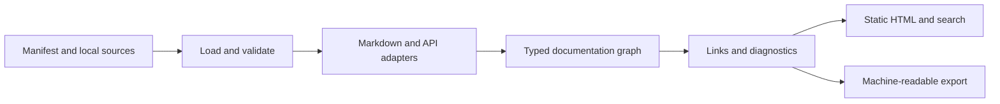

# Documentation system design

Status: draft standard and implementation roadmap. The project is growing from a
protobuf Markdown generator into a documentation compiler and a self-hosted CMS.
The standard covers guides, reference material, tutorials, runbooks, architecture
records and APIs. Protobuf is one input format.

This document records the compiler and CMS foundation and the capabilities still
needed for the complete product. Compatibility with every MkDocs plugin, Scalar
feature or Wiki.js connector remains outside the verified implementation.

## Product and deployment model

Authors keep Markdown, API contracts, examples and a small manifest in Git. A
single Go binary validates the sources and builds a directory of HTML, CSS,
JavaScript, assets and search data. Any static HTTP host can serve that directory,
including a container, an existing reverse proxy, object storage or GitHub Pages.
A static export needs no application process or database.

The same binary also runs the authenticated CMS. Its editor, users, drafts,
history, Git operations and settings use dedicated persistent data directories.
The server embeds its admin assets and composes the application through named Fx
modules. Node.js is a development tool for the editor bundle, not a CMS runtime
requirement. [CMS deployment](cms.md) describes native and Docker startup, private
volumes and offline backup/restore.

CMS requests enforce document and file permissions, including imported sources,
search data and page models. A static export has no per-user authorization;
select its content and hosting access accordingly.

This follows the useful deployment property of
[MkDocs](https://www.mkdocs.org/user-guide/deploying-your-docs/): its generated files
can be served by a static hosting provider. Explicit HTML paths and relative
links are part of our output contract, so hosting below `/team/product/` does not
depend on SPA fallback rules.

Node.js may be used to build optional UI packages. It is not a reader or deployment
requirement. React is appropriate for a complex interactive API panel if that
panel earns its bundle and memory cost; the ordinary reading shell uses HTML and
small progressive enhancements. A React application or mandatory Node server for
every page would add work without helping the static reading path.

The existing `generate`, `lint` and `generate -check` commands remain useful
standalone syntax tools. Site generation uses the same protobuf parser and
deterministic example generation.

## Initial manifest contract

The first site command is:

```console
pb-md5-generator build -config docs.json -o site
pb-md5-generator build -config docs.json -o site -check
```

The defaults are `docs.json` and `site`. Check mode compares expected output
with existing files and does not create directories or write documentation.

```json
{
  "version": 1,
  "title": "Acme documentation",
  "description": "Guides, operations and API reference",
  "pages": [
    {
      "title": "Overview",
      "source": "docs/index.md",
      "path": "index.html"
    },
    {
      "title": "Deployment",
      "source": "docs/deployment.md",
      "path": "operations/deployment.html",
      "kind": "markdown"
    },
    {
      "title": "Accounts API",
      "source": "api/accounts.proto",
      "path": "reference/accounts.html",
      "kind": "protobuf"
    }
  ],
  "assets": ["images/architecture.png"]
}
```

Required manifest fields are `version`, `title` and a nonempty `pages` list.
Each page requires `title`, `source` and `path`. The optional `kind` defaults
to `markdown`; supported kinds are `markdown`, `html`, `protobuf` and `openapi`.
`description`, `$schema` and `assets` are optional. An optional unique page `id`
preserves its identity through path changes; otherwise identity derives from its
output path. The order of `pages` determines navigation order.

Sources and listed assets are local paths relative to the manifest. Reads are
confined to that directory tree. A source does not authorize a network download,
shell command, package installation or executable plugin. The compiler uses
`os.OpenRoot` confinement rather than relying on a cleaned path string alone.
Protobuf import declarations do not trigger dependency downloads.

Output paths are clean relative paths ending in `.html`. Exactly one page
owns `index.html`. Other examples are `guide/install.html` and
`reference/accounts.html`; server-specific extensionless routing is unnecessary.
The compiler owns `_docs/` for its UI assets. Listed user assets are copied
under `assets/`. Generated links must work when the output directory is mounted
at either the origin root or a subpath.

Version 1 is an initial manifest contract, not yet a frozen public standard.
Unknown versions and unsupported fields must produce diagnostics. Before freezing
it, complete the conformance corpus, stable diagnostic codes and an explicit
compatibility policy. Standalone JSON Schemas for manifest, project and page are
already published in the [document format](format.md); schema validation tests
cover positive/negative fixtures and actual compiler exports. Once frozen, a breaking
semantic change requires a new major schema version. New extension kinds require
declared capabilities; a reader must not silently omit content it cannot render.

## Authoring model

Markdown remains the default for ordinary documentation. Headings, links, images,
lists, tables, quotations and fenced code blocks should cover most pages.
The first foundation uses goldmark, heading anchors and an on-page contents list.
Raw HTML in Markdown remains omitted. Explicit `html` pages use an allowlist
sanitizer, the shared link and anchor rules, and bounded HTML parsing. Scripts,
styles, forms and embedded active content are excluded. The
[HTML contract](format.md#explicit-html-documents) describes the supported model.
An author should not need JSX, a JavaScript toolchain or an executable template
to write a guide.

Protobuf comments retain the canonical grouped field annotation:

```protobuf
// Contact address used for notifications.
// @doc type=email example="alice@example.com" max_len=255
string email = 1;
```

Existing forms such as `@min`, `@max`, `@len`, `@val` and `@type` remain
compatible. Ordinary prose, email addresses and mentions remain ordinary prose.
Strict validation distinguishes unknown annotation names, malformed values,
duplicate attributes and attributes that do not apply to the declaration. Fixed
XML examples are validated and malformed documents produce source-located errors.

Numeric `min` and `max` now retain exact validated literals through parsing,
example generation and rendering. Bounds are inclusive; integer domains use
`ceil(min)..floor(max)` without a float64 conversion, including full int64/uint64
endpoints. Empty intervals fail with a source location. A comment-aware lexer
recognizes markers outside source strings, Markdown code and fixed examples.
The [syntax contract](syntax.md) describes accepted grammar and resource bounds.
These changes have boundary, malformed-input, compatibility and fuzz tests; they
do not by themselves freeze the broader standard.

Markdown pages support bounded directives for callouts, tabs and local includes.
The [authoring guide](authoring.md#directive-grammar) specifies the draft grammar,
resource limits and examples:

```markdown
:::note title="Before you begin"
Create a staging account before following this guide.
:::

:::tabs
:::tab title="Go"
~~~go
client.Create(ctx, request)
~~~
:::
:::tab title="cURL"
~~~sh
curl https://api.example.test/accounts
~~~
:::
:::

:::include source="examples/create-account.json" language="json"
:::
```

Directives are parsed as syntax nodes, never by executing author code. Their
attribute grammar uses JSON-quoted strings, validates nesting and reports source
locations. Includes resolve through the confined file loader with cycle, byte,
document and depth limits. Markdown includes keep the originating file's links
and source coordinates; a declared code language makes the included bytes literal.
Tab content remains available without JavaScript and when printed.

Diagrams and API embeds remain proposals. An API embed will reference a stable
import identity declared in the manifest and must have a readable static fallback.
MDX and executable plugins remain separate extension proposals with explicit
trust and deployment contracts. Sanitized HTML pages do not execute author code.

## Internal representation and import boundaries

The target pipeline is:



A typed document model separates the content standard from both the authoring
syntax and the UI. The compiler now exports a project index and one page model
at a time. Markdown becomes typed blocks/inlines; protobuf and OpenAPI adapters
produce operations, schemas and source provenance independently of HTML.
Protobuf also keeps the compatible generated-Markdown reference as a disclosure.
The [format specification](format.md) describes current JSON fields and schemas.

The model contracts and remaining extensions are:

| Entity | Required information |
| --- | --- |
| Project | Schema version, title, ordered page identities and a bounded optional navigation tree; declared extension capabilities remain planned |
| Page | Stable ID, output path, source location, title, kind, content blocks and optional API |
| Block | Typed Markdown blocks/inlines, callouts, tabs and includes with source locations; diagrams and API embeds remain planned |
| Reference | Target ID and optional anchor, independent of output format |
| API | Protocol, source format/version, source provenance, operations, schemas and security requirements |
| Operation | Stable ID, transport identity, summary, parameters, request/response shapes, examples and security |
| Schema | Stable ID, type, constraints and links to other schemas without recursive expansion |
| Diagnostic | Stable code, severity, file, line/column or manifest pointer, and actionable message |

An API adapter retains protocol meaning. A protobuf service has RPC methods and
streaming flags; an HTTP operation has a method, path, status codes and media
types. Inventing HTTP endpoints for gRPC would misrepresent the contract. Schema
references stay references so recursive definitions cannot cause unbounded tree
expansion.

OpenAPI support is explicit for 3.0.x, 3.1.x and 3.2.0. The importer validates
against the corresponding embedded specification schema before normalization.
It retains local source contracts and authored references alongside normalized
data. Remote resolution is disabled; recursion stays as bounded graph edges.
This validates contract structure, not actual server behavior. AsyncAPI and
other formats remain planned adapters. The [API guide](api.md) records supported
semantics, reference handling and request-client limitations.

Extension nodes use a namespace and declare whether they are required for
meaningful rendering. Optional presentation metadata may have a fallback.
Unknown required content produces an error. Content identity, navigation and
ordering must not depend on Go map iteration, a clock or random generation.

`BuildContext` supports cooperative cancellation between bounded phases. API
adapters receive a context and an injected confined loader; they cannot open
arbitrary files or initiate downloads. A fully filesystem/writer-independent
compiler entry point remains planned. The CLI owns flags, process signals, exit
codes and publication. No global mutable parse state or unbounded process cache
should leak into repeated embedded builds.

## Editor, storage and synchronization

A full documentation editor with interchangeable storage and synchronization
adapters is a required part of the target product. Wiki.js is an additional
reference for this workflow. This requirement extends the general documentation
system alongside the reading and API experiences described above.

The CMS foundation now includes local login, administrator/editor/viewer roles,
read/write path grants, a source editor and preview, document and attachment
management, persistent drafts, publication and history. The local filesystem and
Git backends share the managed content transaction. Draft and project revisions
protect concurrent edits; an explicit rebase preserves the author's text when
the published revision changes.

Git publication records the authenticated author, commits managed changes and can
push after publication. The Storage panel enrolls existing local content into Git
without changing sources or the published site. Saved drafts retain their bytes
and require explicit rebase; local history belongs to the enrolled initial branch.
Persisted connections use one pull authority and up to eight independent push
targets that share the same local history. Each target records its own result and
retry state; a failed target does not undo a successful push or local publication.
Connection reads and configuration saves do not contact remotes. SSH credentials
stay in private server storage, outside document Git history and API responses.

Administrators with root read/write grants can create and switch branches, fetch,
pull, push and configure storage. Settings and project revisions are checked
separately, and permissions are refreshed after waiting for the content gate.
An interrupted enrollment uses a private recovery journal and a durable settings
commit point. Source, state and publication directories stay separate from the
project's development checkout. Repository snapshots and include/import consumers
are validated before publication; unsafe paths, symlinks and external resolution
are rejected.

The server renders authorized navigation, search and portable models instead of
exposing its complete generated output directory. Its optional navigation tree
uses stable page IDs, bounded nesting and node counts, DFS ordering and native
group disclosures. Permission projections remove hidden leaves and empty groups
with all their labels and metadata before rendering or export. The global tree
editor requires administrator access to the complete project; ordinary document
deletion can prune its own entry atomically. Omitted tree fields preserve existing
settings, while explicit reset and custom empty trees retain distinct meanings.
Themes and site settings use
the same draft/publication transaction, with portable tokens stored in the
manifest. The [appearance guide](appearance.md) describes the current controls.

The broader Wiki.js-style target remains active. Follow-up work includes more
storage providers, private credential provisioning controls, safe Git-to-local
migration, recursive folder operations and broader attachment handling, a format
registration contract, richer editing workflows,
versions/locales and migration tools. Browser and native-platform acceptance
checks must cover the complete workflows before a release claims that scope.

## UI behavior

The general documentation shell takes its information hierarchy from
[MkDocs navigation and search](https://www.mkdocs.org/user-guide/configuration/).
The API experience targets the operation and schema navigation, request examples
and testing workflow described by
[Scalar API Reference](https://scalar.com/products/api-references).

Desktop layout:

```text
+---------------------------------------------------------------------+
| Product / docs       Search                     Version  Language  ◐ |
+------------------+--------------------------------+-----------------+
| Navigation       | Breadcrumbs                    | On this page    |
|                  | Page title                     |                 |
| Get started      |                                | Overview        |
| Guides           | Prose, tables and code         | Configuration   |
| Operations       |                                | Examples        |
| API reference    | API operation / schema view    |                 |
|                  |                                |                 |
|                  | Previous                  Next |                 |
+------------------+--------------------------------+-----------------+
```

Version and language selectors appear when the project actually declares those
variants. They must not be inert controls. The mobile shell moves navigation and
contents into labeled disclosures; content and code remain usable at narrow
widths.

| Area | Initial foundation | Required follow-up |
| --- | --- | --- |
| Reading | Static and authenticated pages, grouped native navigation, breadcrumbs, heading anchors, contents, DFS previous/next and print styles | Mobile contents disclosure and broader accessibility acceptance |
| Search | Local search data and small browser search UI | Heading-level results, ranking, keyboard palette, bounded worker index for large projects |
| Appearance | Responsive layout, branding, custom light/dark palettes, fonts, spacing, width, radius and navigation controls | Theme package contract, richer customization and visual regression fixtures |
| Authoring | CMS source editor, Markdown, sanitized HTML, protobuf/OpenAPI, assets, drafts/history, typed exports and bounded directives | Richer editing, diagrams, API embeds, format registration and version/locale authoring |
| API reference | Typed operations/schemas, examples, security, bounded property/raw previews and stable anchors | Interactive schema trees, richer operation navigation and selectable examples |
| API client | Explicit HTTP request panel, server/auth/parameter/body controls, cURL, bounded response inspector and cancel | More client languages, browser/live compatibility corpus, OAuth workflow and declared multipart support |
| Publishing | Portable static output, CMS binary/container, Compose, Git synchronization, persistent data and offline backup/restore | Filesystem watch, more connectors, version/locale routing and migration tools |

The API view should keep navigation on the left, operation prose and schema
details in the center, and examples on the right when space permits. Deep links
must address operations and schemas, and global search must find them. Large
schema trees expand on demand with cycle indicators, not a fully materialized
recursive DOM.

The HTTP request panel loads its local page model after explicit interaction.
It previews target server, method, path, headers, body and cURL before sending.
Credentials live in memory and clear on close; page load and search cannot send
API requests. Browser CORS applies. One active operation, a 16 MiB model and a
bounded request body limit the client. Response and timeout settings use bounded
project controls, with defaults of 1 MiB and 30 seconds. JSON/YAML
contract tests, client unit tests and static renderer tests do not replace real
browser verification. OAuth login, cookie auth and multipart/binary uploads are
explicitly unsupported in the first panel. A proxy, if ever added, needs its own
target restrictions and security review.

Use native landmarks and buttons, a skip link, visible focus, keyboard navigation,
labeled search and a polite status region for search results and copy failures.
A theme must preserve contrast and respect reduced motion. Navigation and reading
must work without JavaScript; optional enhancements must fail visibly and leave
content accessible.

## Resource and correctness contracts

Low overhead is a property to measure, not infer from using Go or static HTML.
The [initial performance baseline](performance.md) records a local Markdown corpus
and repeat-build resource checks; API and browser measurements remain required.

The compiler processes pages sequentially and bounds manifest, source, search,
API graph and exported model sizes. A JSON preflight counts encoded bytes before
encoding allocates the document buffer; unknown custom marshalers are rejected. Each build must close input files, release page buffers and return
with no live worker goroutines. Later concurrency must have an explicit bounded
queue. A failed validation must not publish a partly compiled site. Publication
and cleanup must only touch output owned by the compiler.

Before freezing the standard, enforce these additional rules:

- Reject duplicate page IDs, output collisions, paths reserved for generated
  assets, and cross-platform case collisions.
- Resolve internal page links and anchors before publication. Report missing
  targets, conflicting anchors and unsupported schemes with source locations.
- Reject source escape through path traversal or symlinks, output/source overlap
  and attempts to overwrite user source files.
- Bound input bytes, include depth, schema traversal, generated examples and
  search text. Report which limit was exceeded instead of panicking.
- Make check mode detect missing, changed and stale generated files without
  writing. A failed check must leave file bytes and timestamps unchanged.
- Keep output deterministic for identical sources, compiler version and seed.

Proposed performance budgets below are release gates to implement and measure.
They are not benchmark results:

| Measurement | Proposed acceptance gate |
| --- | --- |
| Core reading assets | At most 40 KiB gzip of first-party CSS and JS, excluding content, images and optional API panel |
| Idle reader | No polling timers or network requests after content settles |
| Compiler memory | Under 256 MiB peak RSS for a pinned corpus of 1,000 Markdown pages of about 4 KiB each, plus a separately defined protobuf corpus |
| Repeated builds | After GC, retained heap plateaus over 100 builds; no increasing file-descriptor or goroutine count |
| Reader responsiveness | Search/expand/copy interactions stay below 100 ms on the published reference browser/device corpus |
| Build CPU | Record wall time, CPU time, allocations and bytes per operation for pinned small and large corpora; review regressions above 10% |
| Large API reading | Load interactive code and operation/schema detail on demand; cap DOM growth and request response preview size |

Publish machine, toolchain, corpus hash and raw results with each baseline. A
change in hardware or corpus needs a new baseline. If a budget proves unrealistic,
change it through a documented design decision with evidence.

## Verification and delivery sequence

1. **Static foundation.** Build mixed Markdown/protobuf sites from the versioned
   manifest. Verify deterministic output, path confinement, source and output
   collisions, local asset handling, subpath deployment and read-only check mode.
   Exercise navigation, contents, search, theme, copying and mobile layout in a
   real browser.
2. **Syntax and model.** Publish a formal annotation/directive grammar, JSON
   Schema, typed document/API model and source-located diagnostics. Add fixtures
   for legacy compatibility, unknown syntax, quotes, Unicode, CRLF, nested fences,
   recursive schemas and malformed input. Freeze version 1 only after those
   fixtures pass independently of the HTML renderer.
3. **Authoring parity.** Implement grouped navigation, callouts, tabs, includes,
   diagrams, versions/locales and stable cross-references. Add an example guide,
   runbook and architecture record, plus API docs in one site. These prove the
   product documents more than APIs.
4. **API experience.** Import versioned local OpenAPI contracts, preserve schema
   and security semantics, and implement operation views, language examples and
   an explicitly activated request client. Test against a local mock contract,
   including cancellation, failures, authentication and response limits.
5. **Distribution and performance.** Extend release fixtures for Linux/macOS/
   Windows binaries, static output and optional container serving. Add
   benchmarks, repeated-build resource tests, fuzz seeds, browser accessibility
   checks and portable deployment examples to CI.

6. **CMS acceptance.** Exercise login and revoked permissions, source/file access,
   previews, concurrent drafts and explicit rebase, publication rollback, history,
   Git branches and failed-push recovery, themes, settings and interactive API
   calls. Verify persistence, offline backup/restore, deployment prefixes and
   static delivery independently. Keep browser behavior and native OS execution
   distinct from Node/HTTP tests and cross-compilation.

Each stage must leave a usable product. Keep correctness fixes, tests and relevant
documentation in the same change. Run repository lint, security and test commands
before publishing. A green unit suite alone does not establish browser usability,
a memory plateau, host portability or complete Scalar/MkDocs feature coverage.

The goal is complete only when those behaviors are implemented, documented and
verified against their own acceptance criteria. This roadmap does not narrow that
goal to the first static renderer.

# Implemented visual system

The sections below record the shipped Reference Workspace. The architecture and
roadmap above retain their own acceptance criteria. The frontmatter owns default
primitives; `.impeccable/design.json` extends them with previews and metadata.
Source authority is `internal/site/appearance.go`, `internal/site/ui.go`,
`internal/site/api_style.go` and `internal/studio/web/assets/studio.css`.

## Overview

**Creative North Star: "Reference Workspace"**

A quiet documentation workspace connects Studio, reading and API exploration
through one recognizable shell. White and zinc surfaces, a restrained violet
accent, fine rules and measured typography keep the document or operation in
focus. The API workbench supplies a composed dark companion to the article.

The approved direction is recorded in
`.impeccable/mocks/decision/reference-workspace.html` and
`.impeccable/surfaces/internal-site-ui-go.md`. These are developer references,
not published content assets.

**Key Characteristics:**

- Shared workspace navigation and a narrow project rail.
- Flat document rows and fine boundaries rather than raised document cards.
- Local DM Sans and IBM Plex Mono with explicit fallback stacks.
- Eleven color schemes with complete light and dark palettes.

## Colors

### Primary

Workspace violet is the Default scheme's action, link, selection and focus color.
Its lighter dark-mode counterpart keeps the same role. The API workbench always
uses the chosen scheme's dark palette, including beside a light article.

**The Color-Only Scheme Rule.** Built-in schemes change palette and initial mode;
they share the system font setting, comfortable density, normal width and
five-pixel radius. Personal custom typography remains available.

| Scheme | ID | Initial mode | Light accent | Dark accent |
| --- | --- | --- | --- | --- |
| Default | default | light | #6557d2 | #a99bec |
| Paper | paper | light | #9a3412 | #fdba74 |
| Midnight | midnight | dark | #4338ca | #a5b4fc |
| Ocean | ocean | light | #1d5ea8 | #80bbf4 |
| Forest | forest | light | #246844 | #83c99e |
| Sand | sand | light | #8a571c | #e0b372 |
| Rose | rose | light | #a43762 | #e99cbd |
| Glacier | glacier | light | #17677a | #7dc9db |
| Graphite | graphite | dark | #4f5964 | #b7c2cf |
| Aubergine | aubergine | dark | #7b3e91 | #cf9ce6 |
| Teal Night | teal-night | dark | #166b5c | #7ed0b9 |

Every built-in supplies background, surface, text, muted, border and accent for
both modes. `BuiltinThemes` is the canonical registry of those complete values;
the sidecar's color ramps are preview aids rather than additional theme tokens.

### Neutral

White and quiet zinc distinguish the page, support panel, body text, supporting
text and border. These roles map to `--bg`, `--panel`, `--text`, `--muted` and
`--line`; `--accent` carries the selected scheme's accent. Generated appearance
CSS maps the selected surface to code backgrounds. Studio also has a subtle
surface and a danger color. Status badges retain semantic success and warning
colors independently of the selected scheme.

## Typography

**Display and Body Font:** DM Sans, followed by UI sans and operating-system
fallbacks. **Code Font:** IBM Plex Mono, followed by UI monospace, SFMono-Regular
and Consolas. Local WOFF2 files and OFL license texts ship with both delivery
paths; no font CDN is needed. DM Sans Cyrillic text uses the system fallback;
IBM Plex Mono has local Cyrillic subsets.

The reader's headline, section title and body roles are normative in the
frontmatter. Its next heading is (20px), weight (600). Mobile headlines become
(30px). Studio uses a (28px) main title at weight (600), (16px) section titles,
(15px) subheadings, (13px) labels and controls, and (11px) badges. The reader lead
paragraph is (17px) with a (1.75) line height; navigation uses (13px) text.

**The Reading Measure Rule.** Keep prose, breadcrumbs, adjacent-page links and
footer aligned to the same reading measure. Code keeps its own monospace rhythm.

Serif and mono custom font settings, compact density and wide width are supported
appearance options, rather than alternate built-in visual identities.

## Layout

The shared desktop shell uses a (68px) header and (224px) project rail. Reader
layout adds a flexible article and (200px) contents rail inside an (1800px)
maximum shell. Normal prose measure is (42rem), with wide mode at (48rem);
article width caps are (900px) and (1200px) respectively. Reader content padding
is (34px 40px 48px).

The API surface pairs operation prose and its dark request/example workbench in
an approximately (64:36) content split when space permits. Schema and source
details use progressive disclosure and stable anchors. Long code and tables
scroll inside their own containers.

Studio uses the same shell dimensions, a (1360px) workspace maximum and (36px)
workspace gutter. Its document list is a flat row inventory with aligned actions.
The shared spacing rhythm is (4, 8, 12, 16, 24, 32, 48px).

At (1150px) the reader contents rail becomes an inline disclosure. At (760px)
the reader stacks, its header wraps workspace links and search into rows, and
main padding becomes (26px 20px 40px). At mobile widths, including the verified
(390px) viewport, Studio and API content use one column and document rows stay
flat. Native navigation disclosures retain a usable no-JavaScript path.

## Elevation & Depth

The workspace is flat at rest: tone, spacing and fine borders separate content.
Reader search results use the limited floating shadow
(`0 8px 24px #18181b12`) to distinguish a temporary result layer. Ordinary
document rows and API operations do not inherit that shadow.

**The Flat Workspace Rule.** Reserve floating depth for temporary overlays;
separate ordinary workspace content through alignment, tone and borders.

## Shapes

Built-ins share gently curved (5px) controls and panels, with (4px) badges and
inline code. Borders are fine (1px). Tabs join their content through an underline
and shared edge. Custom appearance can override the reader radius through
`--docs-radius` and the Studio radius through `--radius`.

## Components

### Buttons and fields

Studio controls are compact, with a (36px) minimum height, (7px 12px) button
padding and (13px) text. Primary buttons use accent with background-colored text;
secondary buttons use the page background and a fine border. Hover changes the
border and surface; primary hover uses brightness (.92), and disabled controls
use opacity (.5). Studio focus has a (2px) outline and (3px) offset.

Reader search and theme controls use (36px) height. General reader buttons and
API controls retain their (40px) minimum. Reader focus uses a (3px) outline and
(3px) offset. Copy targets are (40px), increasing to (44px) for mobile or coarse
pointers; code reserves space for them. Inputs retain labels, visible placeholders
and a separate readonly surface.

### Navigation and disclosure

Current workspace tabs have accent underlines; current reader navigation uses
accent text with a ten-percent accent tint. Nested navigation indents under a
fine guide. Secondary API provenance and raw data use native disclosures, while
operation descriptions lead. Schema trees expand without losing stable anchors.
Icons are inline SVG with adjacent text or accessible names.

### Document rows, badges and code

Studio documents use shared row boundaries and aligned metadata/actions, including
on mobile. Badges use a fine border, restrained surface and compact type. Reader
callouts use a semantic leading rule. API method chips, endpoint paths and code
previews use the mono vocabulary; the request panel inherits the chosen dark
palette rather than a fixed accent. Raw payloads remain bounded and scrollable.

## Do's and Don'ts

### Do:

- **Do** preserve the Reference Workspace shell across Studio, reader and API surfaces.
- **Do** keep all eleven built-in schemes color-only and complete in both modes.
- **Do** retain local fonts, visible focus and native disclosure behavior.
- **Do** preserve custom appearance controls and their generated token overrides.
- **Do** register images as project assets before using them in published Markdown.

### Don't:

- **Don't** turn flat document inventories into raised card grids.
- **Don't** replace labeled actions with decorative text glyphs.
- **Don't** ship QA screenshots or developer evidence paths as document images.
- **Don't** treat preview tonal ramps as additional implemented palette values.
- **Don't** treat this visual inventory as evidence that roadmap acceptance gates passed.
