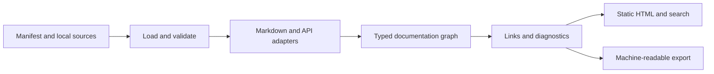

# Documentation system design

Status: draft standard and implementation roadmap. The project is growing from a
protobuf Markdown generator into a documentation compiler. The standard covers
guides, reference material, tutorials, runbooks, architecture records and APIs.
Protobuf is one input format.

This document separates the initial static site foundation from the capabilities
still needed for a complete system. It is not a claim of compatibility with every
MkDocs plugin or Scalar feature.

## Product and deployment model

Authors keep Markdown, API contracts, examples and a small manifest in Git. A
single Go binary validates the sources and builds a directory of HTML, CSS,
JavaScript, assets and search data. Any static HTTP host can serve that directory,
including a container, an existing reverse proxy, object storage or GitHub Pages.
The deployed documentation needs no application process or database.

This follows the useful deployment property of
[MkDocs](https://www.mkdocs.org/user-guide/deploying-your-docs/): its generated files
can be served by a static hosting provider. Explicit HTML paths and relative
links are part of our output contract, so hosting below `/team/product/` does not
depend on SPA fallback rules.

Node.js may be used to build optional UI packages. It is not a reader or deployment
requirement. React is appropriate for a complex interactive API panel if that
panel earns its bundle and memory cost; the ordinary reading shell uses HTML and
small progressive enhancements. A React application or mandatory Node server for
every page would add work without helping the static reading path.

The existing `generate`, `lint` and `generate -check` commands remain useful
standalone syntax tools. Site generation uses the same protobuf parser and
deterministic example generation.

## Initial manifest contract

The first site command is:

```console
pb-md5-generator build -config docs.json -o site
pb-md5-generator build -config docs.json -o site -check
```

The defaults are `docs.json` and `site`. Check mode compares expected output
with existing files and does not create directories or write documentation.

```json
{
  "version": 1,
  "title": "Acme documentation",
  "description": "Guides, operations and API reference",
  "pages": [
    {
      "title": "Overview",
      "source": "docs/index.md",
      "path": "index.html"
    },
    {
      "title": "Deployment",
      "source": "docs/deployment.md",
      "path": "operations/deployment.html",
      "kind": "markdown"
    },
    {
      "title": "Accounts API",
      "source": "api/accounts.proto",
      "path": "reference/accounts.html",
      "kind": "protobuf"
    }
  ],
  "assets": ["images/architecture.png"]
}
```

Required manifest fields are `version`, `title` and a nonempty `pages` list.
Each page requires `title`, `source` and `path`. The optional `kind` defaults
to `markdown`; alternatives are `markdown`, `protobuf` and `openapi`.
`description`, `$schema` and `assets` are optional. An optional unique page `id`
preserves its identity through path changes; otherwise identity derives from its
output path. The order of `pages` determines navigation order.

Sources and listed assets are local paths relative to the manifest. Reads are
confined to that directory tree. A source does not authorize a network download,
shell command, package installation or executable plugin. The compiler uses
`os.OpenRoot` confinement rather than relying on a cleaned path string alone.
Protobuf import declarations do not trigger dependency downloads.

Output paths are clean relative paths ending in `.html`. Exactly one page
owns `index.html`. Other examples are `guide/install.html` and
`reference/accounts.html`; server-specific extensionless routing is unnecessary.
The compiler owns `_docs/` for its UI assets. Listed user assets are copied
under `assets/`. Generated links must work when the output directory is mounted
at either the origin root or a subpath.

Version 1 is an initial manifest contract, not yet a frozen public standard.
Unknown versions and unsupported fields must produce diagnostics. Before freezing
it, complete the conformance corpus, stable diagnostic codes and an explicit
compatibility policy. Standalone JSON Schemas for manifest, project and page are
already published in the [document format](format.md); schema validation tests
cover positive/negative fixtures and actual compiler exports. Once frozen, a breaking
semantic change requires a new major schema version. New extension kinds require
declared capabilities; a reader must not silently omit content it cannot render.

## Authoring model

Markdown remains the default for ordinary documentation. Headings, links, images,
lists, tables, quotations and fenced code blocks should cover most pages.
The first foundation uses goldmark, heading anchors and an on-page contents list.
Raw HTML execution is disabled. An author should not need JSX, a JavaScript
toolchain or an executable template to write a guide.

Protobuf comments retain the canonical grouped field annotation:

```protobuf
// Contact address used for notifications.
// @doc type=email example="alice@example.com" max_len=255
string email = 1;
```

Existing forms such as `@min`, `@max`, `@len`, `@val` and `@type` remain
compatible. Ordinary prose, email addresses and mentions remain ordinary prose.
Strict validation distinguishes unknown annotation names, malformed values,
duplicate attributes and attributes that do not apply to the declaration. Fixed
XML examples are validated and malformed documents produce source-located errors.

Numeric `min` and `max` now retain exact validated literals through parsing,
example generation and rendering. Bounds are inclusive; integer domains use
`ceil(min)..floor(max)` without a float64 conversion, including full int64/uint64
endpoints. Empty intervals fail with a source location. A comment-aware lexer
recognizes markers outside source strings, Markdown code and fixed examples.
The [syntax contract](syntax.md) describes accepted grammar and resource bounds.
These changes have boundary, malformed-input, compatibility and fuzz tests; they
do not by themselves freeze the broader standard.

Markdown pages support bounded directives for callouts, tabs and local includes.
The [authoring guide](authoring.md#directive-grammar) specifies the draft grammar,
resource limits and examples:

```markdown
:::note title="Before you begin"
Create a staging account before following this guide.
:::

:::tabs
:::tab title="Go"
~~~go
client.Create(ctx, request)
~~~
:::
:::tab title="cURL"
~~~sh
curl https://api.example.test/accounts
~~~
:::
:::

:::include source="examples/create-account.json" language="json"
:::
```

Directives are parsed as syntax nodes, never by executing author code. Their
attribute grammar uses JSON-quoted strings, validates nesting and reports source
locations. Includes resolve through the confined file loader with cycle, byte,
document and depth limits. Markdown includes keep the originating file's links
and source coordinates; a declared code language makes the included bytes literal.
Tab content remains available without JavaScript and when printed.

Diagrams and API embeds remain proposals. An API embed will reference a stable
import identity declared in the manifest and must have a readable static fallback.
Arbitrary HTML, MDX and executable plugins are separate opt-in extension proposals
with explicit trust and deployment contracts.

## Internal representation and import boundaries

The target pipeline is:



A typed document model separates the content standard from both the authoring
syntax and the UI. The compiler now exports a project index and one page model
at a time. Markdown becomes typed blocks/inlines; protobuf and OpenAPI adapters
produce operations, schemas and source provenance independently of HTML.
Protobuf also keeps the compatible generated-Markdown reference as a disclosure.
The [format specification](format.md) describes current JSON fields and schemas.

The model contracts and remaining extensions are:

| Entity | Required information |
| --- | --- |
| Project | Schema version, title and ordered page identities; grouped navigation and capabilities remain planned |
| Page | Stable ID, output path, source location, title, kind, content blocks and optional API |
| Block | Typed Markdown blocks/inlines, callouts, tabs and includes with source locations; diagrams and API embeds remain planned |
| Reference | Target ID and optional anchor, independent of output format |
| API | Protocol, source format/version, source provenance, operations, schemas and security requirements |
| Operation | Stable ID, transport identity, summary, parameters, request/response shapes, examples and security |
| Schema | Stable ID, type, constraints and links to other schemas without recursive expansion |
| Diagnostic | Stable code, severity, file, line/column or manifest pointer, and actionable message |

An API adapter retains protocol meaning. A protobuf service has RPC methods and
streaming flags; an HTTP operation has a method, path, status codes and media
types. Inventing HTTP endpoints for gRPC would misrepresent the contract. Schema
references stay references so recursive definitions cannot cause unbounded tree
expansion.

OpenAPI support is explicit for 3.0.x, 3.1.x and 3.2.0. The importer validates
against the corresponding embedded specification schema before normalization.
It retains local source contracts and authored references alongside normalized
data. Remote resolution is disabled; recursion stays as bounded graph edges.
This validates contract structure, not actual server behavior. AsyncAPI and
other formats remain planned adapters. The [API guide](api.md) records supported
semantics, reference handling and request-client limitations.

Extension nodes use a namespace and declare whether they are required for
meaningful rendering. Optional presentation metadata may have a fallback.
Unknown required content produces an error. Content identity, navigation and
ordering must not depend on Go map iteration, a clock or random generation.

`BuildContext` supports cooperative cancellation between bounded phases. API
adapters receive a context and an injected confined loader; they cannot open
arbitrary files or initiate downloads. A fully filesystem/writer-independent
compiler entry point remains planned. The CLI owns flags, process signals, exit
codes and publication. No global mutable parse state or unbounded process cache
should leak into repeated embedded builds.

## Editor, storage and synchronization

A full documentation editor with interchangeable storage and synchronization
adapters is a required part of the target product. Wiki.js is an additional
reference for this workflow. This requirement extends the general documentation
system alongside the reading and API experiences described above.

The editor must support authoring and saving documentation through the UI and
working with multiple storage and synchronization backends. Backend selection,
conflict handling, authentication and the boundary between editing and static
publication need an explicit design before implementation. Preserve stable
content identities, portable exports and the low resource goals across these
workflows.

The editor and its connectors are future work. They are not implemented in this
static compiler and Docker delivery slice; specific backends have not yet been
selected.

## UI behavior

The general documentation shell takes its information hierarchy from
[MkDocs navigation and search](https://www.mkdocs.org/user-guide/configuration/).
The API experience targets the operation and schema navigation, request examples
and testing workflow described by
[Scalar API Reference](https://scalar.com/products/api-references).

Desktop layout:

```text
+---------------------------------------------------------------------+
| Product / docs       Search                     Version  Language  ◐ |
+------------------+--------------------------------+-----------------+
| Navigation       | Breadcrumbs                    | On this page    |
|                  | Page title                     |                 |
| Get started      |                                | Overview        |
| Guides           | Prose, tables and code         | Configuration   |
| Operations       |                                | Examples        |
| API reference    | API operation / schema view    |                 |
|                  |                                |                 |
|                  | Previous                  Next |                 |
+------------------+--------------------------------+-----------------+
```

Version and language selectors appear when the project actually declares those
variants. They must not be inert controls. The mobile shell moves navigation and
contents into labeled disclosures; content and code remain usable at narrow
widths.

| Area | Initial foundation | Required follow-up |
| --- | --- | --- |
| Reading | Local static pages, global navigation, breadcrumbs, heading anchors, contents and print styles | Grouped navigation, previous/next and mobile contents disclosure |
| Search | Local search data and small browser search UI | Heading-level results, ranking, keyboard palette, bounded worker index for large projects |
| Appearance | Responsive layout, light/dark theme and copy controls | Custom brand tokens, theme package contract and visual regression fixtures |
| Authoring | Markdown, protobuf and local OpenAPI pages, listed assets, typed exports, callouts, tabs and reusable local includes | Diagrams, API embeds and version/locale authoring |
| API reference | Typed operations/schemas, examples, security, bounded property/raw previews and stable anchors | Interactive schema trees, richer operation navigation and selectable examples |
| API client | Explicit HTTP request panel, server/auth/parameter/body controls, cURL, bounded response inspector and cancel | More client languages, browser/live compatibility corpus, OAuth workflow and declared multipart support |
| Publishing | Portable static output, site/CLI Docker images and Compose preview | Preview/watch, optional single-binary serving, version/locale routing, migration tools |

The API view should keep navigation on the left, operation prose and schema
details in the center, and examples on the right when space permits. Deep links
must address operations and schemas, and global search must find them. Large
schema trees expand on demand with cycle indicators, not a fully materialized
recursive DOM.

The HTTP request panel loads its local page model after explicit interaction.
It previews target server, method, path, headers, body and cURL before sending.
Credentials live in memory and clear on close; page load and search cannot send
API requests. Browser CORS applies. One active operation, a 16 MiB model, 1 MiB
request/response bodies and a 30-second timeout bound the client. JSON/YAML
contract tests, client unit tests and static renderer tests do not replace real
browser verification. OAuth login, cookie auth and multipart/binary uploads are
explicitly unsupported in the first panel. A proxy, if ever added, needs its own
target restrictions and security review.

Use native landmarks and buttons, a skip link, visible focus, keyboard navigation,
labeled search and a polite status region for search results and copy failures.
A theme must preserve contrast and respect reduced motion. Navigation and reading
must work without JavaScript; optional enhancements must fail visibly and leave
content accessible.

## Resource and correctness contracts

Low overhead is a property to measure, not infer from using Go or static HTML.
The [initial performance baseline](performance.md) records a local Markdown corpus
and repeat-build resource checks; API and browser measurements remain required.

The compiler processes pages sequentially and bounds manifest, source, search,
API graph and exported model sizes. A JSON preflight counts encoded bytes before
encoding allocates the document buffer; unknown custom marshalers are rejected. Each build must close input files, release page buffers and return
with no live worker goroutines. Later concurrency must have an explicit bounded
queue. A failed validation must not publish a partly compiled site. Publication
and cleanup must only touch output owned by the compiler.

Before freezing the standard, enforce these additional rules:

- Reject duplicate page IDs, output collisions, paths reserved for generated
  assets, and cross-platform case collisions.
- Resolve internal page links and anchors before publication. Report missing
  targets, conflicting anchors and unsupported schemes with source locations.
- Reject source escape through path traversal or symlinks, output/source overlap
  and attempts to overwrite user source files.
- Bound input bytes, include depth, schema traversal, generated examples and
  search text. Report which limit was exceeded instead of panicking.
- Make check mode detect missing, changed and stale generated files without
  writing. A failed check must leave file bytes and timestamps unchanged.
- Keep output deterministic for identical sources, compiler version and seed.

Proposed performance budgets below are release gates to implement and measure.
They are not benchmark results:

| Measurement | Proposed acceptance gate |
| --- | --- |
| Core reading assets | At most 40 KiB gzip of first-party CSS and JS, excluding content, images and optional API panel |
| Idle reader | No polling timers or network requests after content settles |
| Compiler memory | Under 256 MiB peak RSS for a pinned corpus of 1,000 Markdown pages of about 4 KiB each, plus a separately defined protobuf corpus |
| Repeated builds | After GC, retained heap plateaus over 100 builds; no increasing file-descriptor or goroutine count |
| Reader responsiveness | Search/expand/copy interactions stay below 100 ms on the published reference browser/device corpus |
| Build CPU | Record wall time, CPU time, allocations and bytes per operation for pinned small and large corpora; review regressions above 10% |
| Large API reading | Load interactive code and operation/schema detail on demand; cap DOM growth and request response preview size |

Publish machine, toolchain, corpus hash and raw results with each baseline. A
change in hardware or corpus needs a new baseline. If a budget proves unrealistic,
change it through a documented design decision with evidence.

## Verification and delivery sequence

1. **Static foundation.** Build mixed Markdown/protobuf sites from the versioned
   manifest. Verify deterministic output, path confinement, source and output
   collisions, local asset handling, subpath deployment and read-only check mode.
   Exercise navigation, contents, search, theme, copying and mobile layout in a
   real browser.
2. **Syntax and model.** Publish a formal annotation/directive grammar, JSON
   Schema, typed document/API model and source-located diagnostics. Add fixtures
   for legacy compatibility, unknown syntax, quotes, Unicode, CRLF, nested fences,
   recursive schemas and malformed input. Freeze version 1 only after those
   fixtures pass independently of the HTML renderer.
3. **Authoring parity.** Implement grouped navigation, callouts, tabs, includes,
   diagrams, versions/locales and stable cross-references. Add an example guide,
   runbook and architecture record, plus API docs in one site. These prove the
   product documents more than APIs.
4. **API experience.** Import versioned local OpenAPI contracts, preserve schema
   and security semantics, and implement operation views, language examples and
   an explicitly activated request client. Test against a local mock contract,
   including cancellation, failures, authentication and response limits.
5. **Distribution and performance.** Extend release fixtures for Linux/macOS/
   Windows binaries, static output and optional container serving. Add
   benchmarks, repeated-build resource tests, fuzz seeds, browser accessibility
   checks and portable deployment examples to CI.

Each stage must leave a usable product. Keep correctness fixes, tests and relevant
documentation in the same change. Run repository lint, security and test commands
before publishing. A green unit suite alone does not establish browser usability,
a memory plateau, host portability or complete Scalar/MkDocs feature coverage.

The goal is complete only when those behaviors are implemented, documented and
verified against their own acceptance criteria. This roadmap does not narrow that
goal to the first static renderer.
